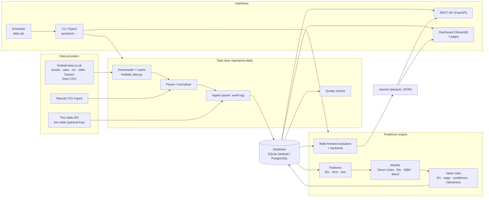

# System architecture

## Overview



Everything is Python. The dashboard, API and CLI all call the same library (`src/sportpred`),
so a calculation is implemented exactly once.

## Why this stack (decisions in plain language)

| Choice | Why | Alternative considered |
|---|---|---|
| **Python** for everything | All serious statistics/ML libraries are Python; one language is easier for a non-programmer and for AI coding tools | Python engine + TypeScript frontend (two languages, twice the code) |
| **Streamlit** dashboard | Pages are plain Python, charts in a few lines, easy for AI tools to edit; good enough for a single-user research tool | Next.js/React: nicer for a public product, but ~3× more code to maintain. The REST API already exists if a React UI is wanted later |
| **FastAPI** REST API | Standard, typed, automatic docs at `/docs`; lets other tools use the predictions | Flask (less typing / docs) |
| **SQLite** default, **PostgreSQL** optional | SQLite needs zero installation; the same SQLAlchemy schema runs on PostgreSQL via one setting (used by docker compose) | PostgreSQL only (needs a server from day one) |
| **SQLAlchemy 2.0** | One schema for both databases, safe parameterised queries | Raw SQL |
| **pandas / NumPy / SciPy** | Data wrangling and the Dixon-Coles optimiser (analytic gradient, ~40 ms per fit) | — |
| **scikit-learn + LightGBM** | Gradient boosting challenger model | XGBoost (similar; LightGBM is faster on CPU) |
| **Typer CLI** | Every job can run from a terminal or a scheduler | — |
| **Docker compose** | Reproducible deployment: db + dashboard + API + scheduler | Manual install (documented too) |

## Source layout

```
src/sportpred/
  config.py            environment settings (.env) + model settings (YAML)
  db.py                database schema (tables listed below) and sessions
  leagues.py           league catalogue and season helpers
  cli.py               command line: init, update, quality, evaluate, backtest, predict, daily, schedule…
  data/
    football_data.py   download + parse football-data.co.uk CSVs (all historical column layouts)
    odds_api.py        optional The Odds API client (only active with a key)
    ingest.py          upsert into the database, audit log, stale/rescheduled fixtures, CSV import
    quality.py         data quality checks and coverage report
    repository.py      analysis frames: matches + odds (wide) + fair reference probabilities
  features/
    elo.py             sequential Elo (no same-day leakage, promoted-team prior)
    form.py            pre-match rolling form (merge_asof, strictly earlier dates)
  models/
    base.py            model interface, per-league wrapper
    dixon_coles.py     Dixon-Coles with time decay, ridge, newcomer prior, bootstrap intervals
    elo_model.py       Elo + ordered logit
    gbm.py             LightGBM challenger (walk-forward)
    blend.py           log-linear pooling (blend / ensemble)
    registry.py        model names and factories
  betting/
    odds.py            implied probability, margin, de-vig (multiplicative/power/Shin), EV, Kelly, CLV
    staking.py         flat / fractional Kelly with exposure caps, Monte Carlo
  evaluation/
    metrics.py         log loss, Brier, RPS, calibration, bootstrap CIs, drawdown
    walkforward.py     rolling-origin validation with leakage guard
    backtest.py        bet selection, P&L, CLV, baselines, threshold sensitivity
  services/
    predictions.py     live predictions, value classification, explanations
    evaluation.py      walk-forward runs for all models, summaries, model versions
    paper.py           paper-trading ledger and settlement
    analysis.py        form tables, head-to-head, league table
    jobs.py            daily job + markdown report
  api/main.py          FastAPI app
app/                   Streamlit dashboard (main.py + pages/)
tests/                 pytest suite (simulated data only)
scripts/               league screening, database backup
config/                default_settings.yaml (committed defaults)
reports/               committed research evidence (screening, evaluation summary)
data/                  local only: database, raw downloads, walk-forward files (git-ignored)
```

## Database tables

| Table | Purpose |
|---|---|
| `matches` | one row per match: league, season, date, teams, status (`finished`/`scheduled`/`stale`/`superseded`), score, shots, cards, xG, provenance, `data_label` (`live`/`sample`/`simulated`) |
| `odds` | prices per match × bookmaker × market (1X2, OU, AH) × line × pre-closing/closing, with `collected_at` |
| `data_updates` | audit log of every download/import: source, file, time, status, rows, SHA-256 of the file |
| `model_versions` | every model configuration that produced stored predictions or evaluation metrics |
| `predictions` | append-only predictions (one `run_id` per run) with probabilities, intervals, odds, EV, verdict, reasons |
| `paper_bets` | hypothetical bets for value recommendations, settled after the match with CLV |
| `backtest_runs` | saved backtest configurations and summaries (reserved for future use) |

## Data flow for a live prediction

1. `update`: download current-season files + `fixtures.csv`; unchanged files are skipped (hash check).
2. For each league with upcoming fixtures: fit Dixon-Coles on finished matches **before today**
   (+30 Bayesian-bootstrap refits for uncertainty), fit Elo (second opinion).
3. Take the latest pre-closing odds; compute the sharp anchor (Pinnacle → market average → Exchange),
   de-vig it, and pool it with Dixon-Coles using the out-of-sample blend weights.
4. For every selection: best real bookmaker price, implied probability, edge, EV, EV at the low end
   of the uncertainty band, confidence → verdict (`value` / `insufficient_evidence` / `no_bet`).
5. Store predictions (append-only), log paper bets for recommended selections, write the daily report.

## Leakage protections (why backtests can be trusted)

* Walk-forward only: a model predicting week *W* is fitted on matches dated strictly before *W*
  (`LeakageError` is raised otherwise). Never random splits.
* Features use `merge_asof(..., allow_exact_matches=False)`: only strictly earlier dates.
* Elo ratings for all matches on one day use ratings from before that day.
* Bets are struck at **pre-closing** prices; closing prices are used only to measure CLV.
* Pooling weights for season *S* are fitted on out-of-sample rows from seasons before *S*.
* A test (`test_walk_forward_has_no_lookahead`) changes future results and asserts that earlier
  predictions do not change.
